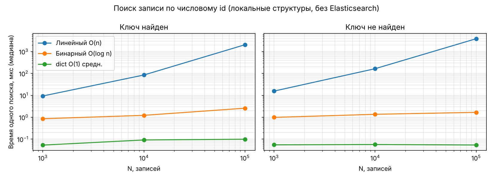
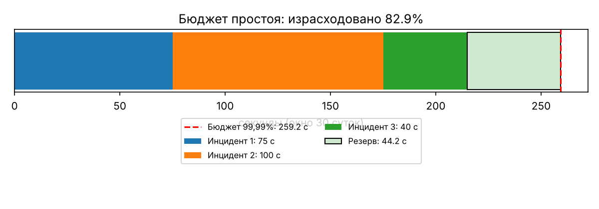
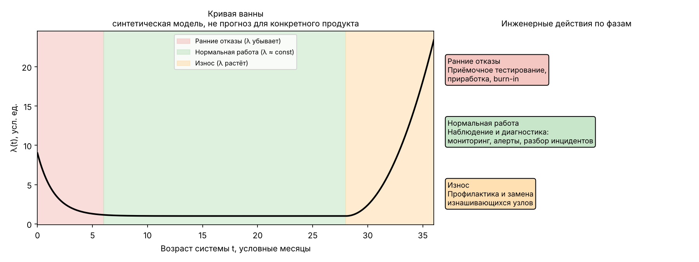

# SiteScope

Сравнительный аудит двух сайтов, поиск по каталогу на Elasticsearch, бенчмарк алгоритмов поиска, калькулятор доступности и модель «кривой ванны».

## Структура

```
src/        generate_data.py  index_data.py  search_queries.py  search.py
            benchmark.py      availability.py  bathtub.py
data/       catalog.jsonl — синтетический каталог, 1020 документов (seed = 42, из них 20 подготовлены вручную)
queries/    scenario_1…6 — Elasticsearch Query DSL
results/    CSV/JSON, диаграммы, sitescope_tables.xlsx — таблицы № 1–5
tests/      test_project.py — 13 тестов
docker-compose.yml   requirements.txt
```

## Требования

- Python 3.11+
- Docker и не менее 2 ГБ свободной RAM (Elasticsearch, heap 1 ГБ)
- Elasticsearch 8.15.0 (образ `docker.elastic.co/elasticsearch/elasticsearch:8.15.0`)
- Зависимости: `pip install -r requirements.txt` (`elasticsearch`, `matplotlib`, `pytest`)

## Запуск

```bash
python -m venv .venv && source .venv/bin/activate
pip install -r requirements.txt

python src/generate_data.py        # data/catalog.jsonl
docker compose up -d               # Elasticsearch на 127.0.0.1:9200
python src/index_data.py           # индекс sitescope-pages, версия ES, число документов
python src/search_queries.py       # results/es_results.json
python src/search.py --query "бинарный поиск" --category algorithms --limit 5

python src/benchmark.py            # results/benchmark.csv, benchmark.png
python src/availability.py         # results/downtime_budgets.csv, incidents.json, downtime_budget.png
python src/bathtub.py              # results/bathtub.png
python -m unittest discover -s tests -v
```

## Часть I. Аудит двух сайтов (таблица № 1)

| Показатель | Сайт A: моб. / ПК | Сайт Б: моб. / ПК | Вывод и приоритет |
|---|---|---|---|
| URL и дата проверки | | | |
| Performance | | | |
| Accessibility | | | |
| Best Practices | | | |
| SEO | | | |
| LCP, с | | | |
| CLS | | | |
| TBT, мс | | | |
| 3 проблемы на сайт | | | |

Рабочая версия с усреднением двух запусков: `results/sitescope_tables.xlsx`, листы «Т1 запуски» и «Т1».

## Часть II. Поиск на Elasticsearch (таблица № 2)

Индекс `sitescope-pages`, один шард, без реплик. Mapping: `id`, `category`, `tags` — keyword; `title`, `description` — text (анализатор `russian`); `published_at` — date. Загрузка — `helpers.bulk` из `src/index_data.py`.

| Сценарий | DSL | Факт |
|---|---|---|
| term по category | `queries/scenario_1_term_category.json` | |
| match по title | `queries/scenario_2_match_title.json` | |
| match по description | `queries/scenario_3_match_description.json` | |
| bool + filter | `queries/scenario_4_bool_filter.json` | |
| match_phrase | `queries/scenario_5_match_phrase.json` | |
| range по дате | `queries/scenario_6_range_date.json` | |

| Запрос | Эталон | P@5 |
|---|---|---|
| python списки и словари | manual-01, 02, 03 | |
| elasticsearch индекс mapping | manual-04, 05, 06 | |
| доступность бюджет простоя | manual-07, 08, 09 | |
| кривая ванны надёжность | manual-10, 11, 12 | |
| бинарный поиск алгоритм | manual-13, 14, 15 | |
| **Среднее** | | |

Порядок выдачи определяется BM25 (частота терма, редкость терма, длина поля) после анализа текста, а не наличием подстроки.

## Часть III. Бенчмарк поиска по id (таблица № 3)

Три решения одной задачи: линейный поиск O(n), бинарный O(log n), `dict` O(1) в среднем. Для каждого N: 100 существующих и 100 отсутствующих ключей, 7 повторов, медиана `time.perf_counter_ns`. Результаты трёх алгоритмов сверяются между собой. Среда: Linux-6.18.44-fc-v310-x86_64-with-glibc2.39, Python 3.12.3.

| N / условие | Линейный, мкс | Бинарный, мкс | Dict, мкс |
|---|---|---|---|
| 1 000 / найден | 9,36 | 0,86 | 0,054 |
| 1 000 / не найден | 15,66 | 0,99 | 0,055 |
| 10 000 / найден | 84,85 | 1,22 | 0,092 |
| 10 000 / не найден | 164,56 | 1,36 | 0,057 |
| 100 000 / найден | 2 040,42 | 2,59 | 0,100 |
| 100 000 / не найден | 3 840,97 | 1,67 | 0,054 |

Подготовка структур (разово):

| N | Сортировка списка, мкс | Построение dict, мкс |
|---|---|---|
| N = 1 000 | 187,2 | 83,6 |
| N = 10 000 | 4 330,7 | 934,5 |
| N = 100 000 | 102 316,9 | 34 924,6 |



Бинарный поиск оправдан, когда данные уже отсортированы или сортировка окупается числом запросов (стоимость O(n log n)). Словарь быстрее всех, но требует памяти под хеш-таблицу и времени на построение. Elasticsearch не сравнивается с этими структурами: запрос по HTTP включает сеть, анализ текста, индекс, расчёт релевантности и ранжирование.

## Часть IV. Доступность и бюджет простоя (таблица № 4)

A = (T − D) / T × 100 %, Dmax = T × (1 − A_target / 100). Временна́я доступность, плановые работы не исключаются.

| Период / цель | T | Dmax |
|---|---|---|
| 24 часа / 99,99 % | 86 400,00 с | 8,64 с (0,14 мин) |
| 7 суток / 99,99 % | 604 800,00 с | 60,48 с (1,01 мин) |
| 30 суток / 99,99 % | 2 592 000,00 с | 259,20 с (4,32 мин) |
| 365 суток / 99,99 % | 31 536 000,00 с | 3 153,60 с (52,56 мин) |

Бюджет простоя, минуты:

| Цель | 24 часа | 7 суток | 30 суток | 365 суток |
|---|---|---|---|---|
| 99 % | 14,400 | 100,800 | 432,000 | 5 256,000 |
| 99,9 % | 1,440 | 10,080 | 43,200 | 525,600 |
| 99,95 % | 0,720 | 5,040 | 21,600 | 262,800 |
| 99,99 % | 0,144 | 1,008 | 4,320 | 52,560 |
| 99,999 % | 0,014 | 0,101 | 0,432 | 5,256 |

Инциденты в окне 30 суток (T = 2 592 000 с): 75 с, 100 с, 40 с.

| Показатель | Значение |
|---|---|
| Суммарный простой D | 215 с |
| Фактическая доступность A | 99,99171 % |
| Бюджет для 99,99 % | 259,20 с |
| Израсходовано бюджета | 82,95 % |
| Остаток | 44,20 с |
| Выдержит ещё 60 с | нет |
| MTTR | 71,67 с |
| MTBF | 863 928,3 с |
| MTBF / (MTBF + MTTR) | 99,99171 % |

MTBF считается для ремонтируемой системы при непрерывном наблюдении, один инцидент — один отказ; при этих допущениях MTBF/(MTBF+MTTR) совпадает с A. Доля успешных запросов при частичной деградации может отличаться от временно́й доступности.



## Часть V. Кривая ванны (таблица № 5)

| Период | λ(t) | Причина и пример | Мера контроля |
|---|---|---|---|
| Ранние отказы (0–6 усл. мес.) | убывает | дефекты производства и монтажа, ошибки настройки нового сервера | приёмочное тестирование, приработка |
| Нормальная работа (6–28) | примерно постоянна | случайные отказы, редкие внешние сбои | мониторинг, алерты, диагностика |
| Износ (28–36) | возрастает | старение дисков, вентиляторов, батарей, ресурс SSD | профилактика, плановая замена узлов |
| Ограничения | синтетическая схема | не прогноз для конкретного продукта | — |



Схема применима к аппаратным системам и ремонтируемым компонентам; программный продукт сам по времени не изнашивается. Интенсивность отказов λ(t) не равна проценту доступности.

## Безопасность и ограничения

- Elasticsearch запускается локально без аутентификации (`xpack.security.enabled=false`), порт привязан к `127.0.0.1`. Не открывайте сервис в интернет.
- Данные каталога синтетические, секретов в репозитории нет.
- Время в бенчмарке зависит от машины и фоновой нагрузки.
